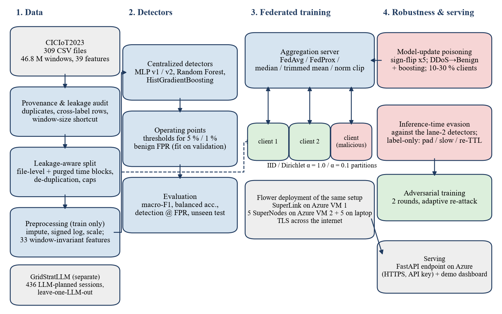

# About the Project {.unlisted}
### AI-Enabled Cyberattack Detection and Adversarially Robust Federated Intrusion Detection
### Vinit Soni (E23CSEU0437) - School of Computer Science Engineering and Technology, Bennett University

::: toc
:::

## 1. What the project is

The project builds and tests an **intrusion detection system (IDS)** for Internet-of-Things (IoT) networks: a
machine-learning model that looks at network traffic and decides whether it is an attack, and which kind.

The model is trained in two ways:

* **Centralised:** all training data on one machine.
* **Federated:** several sites (clients) train one shared model together. Each site keeps its own traffic; only
  model weights are sent to a server, which combines them. This matters because organisations cannot share raw
  network traffic - it is private.

The project then attacks its own system in two ways and tests a defence for each, checks whether attacks planned
by AI language models (LLMs) can be detected, runs the federated system for real on **Microsoft Azure**, and
scores real, everyday traffic recorded on a laptop (normal traffic only, no attacks).

## 2. Objectives

1. Build a leakage-free evaluation of IoT intrusion detection on CICIoT2023 (no duplicate rows shared between
   training and test data).
2. Compare centralised training with federated training (FedAvg, FedProx) for evenly spread (IID) and unevenly
   spread (non-IID) client data.
3. Measure **model-update poisoning** by malicious federated clients, and defend with robust aggregation.
4. Measure **evasion** by attackers who disguise their own traffic, and defend with adversarial training.
5. Test detection of **LLM-planned attacks** on a smart-grid testbed (GridStratLLM).
6. Deploy the federated system across real machines (Azure VMs and a laptop) and serve the trained model.

## 3. Why it was needed

* Published CICIoT2023 results report F1 scores of 0.92-0.99, but our audit found **55.0 % exact duplicate rows**
  and **30.6 %** of rows sharing their features with a different class. Random splits inflate the scores.
* Poisoning and evasion are studied in separate papers, never on the same detector.
* No study had tested detection of attacks planned by LLMs.
* Every federated IDS study we reviewed is simulation only.
* No study fixes the false-alarm rate, although that is how a detector is used in practice.

## 4. System architecture



**Data.** CICIoT2023 (46.8 million traffic windows; 34 classes = benign + 33 attack types in 7 families) and GridStratLLM
(436 attack sessions planned by four LLMs on a smart-grid testbed). The data is split by capture file and time,
de-duplicated, and preprocessed with statistics from the training data only.

**Detectors.** A multilayer perceptron (MLP, PyTorch) and tree baselines (Random Forest, HistGradientBoosting).
Thresholds are fitted on validation data so that at most 5 % or 1 % of normal traffic is flagged.

**Federated learning.** A simulator for the large experiment grids, and the same model and data partitions as a
real **Flower** deployment: the server on one Azure VM, five clients on a second Azure VM and five on the laptop,
connected over TLS.

**Attacks and defences.** Poisoning (sign-flip, DDoS-to-Benign relabelling) against median, trimmed mean and
norm clipping; evasion (padding, slowing down, changing TTL - only what a real attacker controls) against
adversarial training.

**Serving.** A secured prediction API (FastAPI in Docker, API key, HTTPS) and a web dashboard, both on the Azure
VM, reached through an SSH tunnel so that nothing is open to the public internet.

## 5. Technology used

| Area | Tools |
|---|---|
| Language | Python 3 |
| Machine learning | PyTorch (MLP), scikit-learn (Random Forest, HistGradientBoosting), NumPy, pandas, Polars |
| Federated learning | Own simulator; Flower 1.42 for the real deployment |
| Cloud | Microsoft Azure: 2 Linux VMs, virtual network, network security group, budget alert |
| Serving | FastAPI, Uvicorn, Docker, TLS certificates, API key |
| Real traffic | Wireshark / Npcap captures, own pcap reader and CICIoT2023 feature extractor |
| Testing | pytest - 76 automated tests, including leakage tests on the real split |
| Documents | Markdown + pandoc (report, review), LaTeX on Overleaf (IEEE paper), PowerPoint (slides) |
| Version control | Git and GitHub (github.com/vinitsoni03/federated-ids), tagged releases |

## 6. Project structure

```
federated-ids/
  src/federated_ids/
    data/          dataset audit, leakage-aware splits, preprocessing
    models/        MLP and local training (incl. FedProx term)
    federated/     client partitions (IID / Dirichlet), aggregators, simulator
    attacks/       poisoning and constrained black-box evasion
    evaluation/    metrics, threshold calibration, whole-test-pool scoring
    experiments/   centralised, federated, evasion, adversarial training runs
    gridstrat/     GridStratLLM (LLM-planned attacks) analysis
    live/          real-traffic capture reader and scoring
  flower_app/      Flower server and client apps for the real deployment
  serving/         secured prediction API (FastAPI + Dockerfile)
  demo/            web dashboard (app.py + static page + model bundle)
  scripts/         experiment grids, figures, documents
  scripts/azure/   Azure deployment (VMs, endpoint, dashboard)
  tests/           76 unit, leakage and integration tests
  configs/         data, centralised and federated settings
  reports/         report, literature review, paper PDF, slides, figures
  paper/           IEEE paper source (LaTeX)
```

## 7. Main results

| Question | Result |
|---|---|
| Detection, 8 classes (leakage-free split) | Macro-F1 0.687 (MLP), 0.709 (Random Forest) - within 0.01-0.03 of the dataset authors' own benchmark |
| Attacks caught at 1 % false alarms | 83-86 % |
| Federated vs centralised (IID clients) | Only 0.6-2.5 points of detection lost |
| Strong label skew (Dirichlet α = 0.1) | FedAvg and FedProx both break (open problem) |
| Poisoning, 2 of 10 clients malicious | FedAvg collapses; median and trimmed mean protect it with IID clients |
| Evasion at the 1 % threshold | 24-49 % of detected attacks evade; 8-17 % after 2 rounds of adversarial training |
| LLM-planned attacks | Detected for every planning LLM (AUC 0.90-1.00), even without the ARP signature |
| Real deployment (Azure + laptop) | Test macro-F1 0.6692 - identical to the simulator |
| Real laptop traffic | 86-89 % false alarms; 0.45 % after adding 2.6 minutes of local normal traffic to training |

## 8. How it compares with earlier work

The project builds on five papers: Neto et al. 2023 (the CICIoT2023 dataset), Bilal et al. 2026 (federated IDS
benchmark), Nayak and Reddy 2026 (poisoning defences), Kampourakis et al. 2026 (LLM-generated traffic) and
Kellerer and Hagenmeyer 2026 (GridStratLLM). Its scores are lower than the 0.92-0.99 reported by some of them
because the split removes duplicate rows. What it adds is a stricter evaluation and a wider scope: a fixed
false-alarm rate, poisoning and evasion on the same detector, LLM-planned attacks, a real cloud deployment and a
real-traffic test. Details: `reports/literature_review.pdf`, sections 4 and 5.

## 9. Limitations

* One dataset release, one split and one hardware setup; the poisoning sweep and non-IID poisoning use one seed.
* Evasion is modelled on features, not replayed as real packets.
* The real-traffic test covers one laptop, one network and one session.
* Multi-Krum, FLTrust and formal privacy (differential privacy, secure aggregation) were not evaluated.
* Real vs recorded data: all attack traffic comes from the two lab-recorded datasets, and poisoning and
  evasion run in software on that data - no real system or network was attacked. The real-traffic test uses
  real, attack-free laptop traffic, recorded with Wireshark and then scored, so it measures false alarms only.

## 10. Deliverables

| Document | File |
|---|---|
| Final report | `reports/final_report.pdf` (also `.docx`, `.md`) |
| IEEE research paper | `reports/federated_ids_paper.pdf` (LaTeX source in `paper/`) |
| Literature review and research gaps | `reports/literature_review.pdf` (also `.docx`, `.md`) |
| Presentation | `reports/final_slides.pdf` (also `.pptx`) |
| About the project (this document) | `reports/about_the_project.pdf` (also `.docx`, `.md`) |
| Code, tests and run records | github.com/vinitsoni03/federated-ids |
