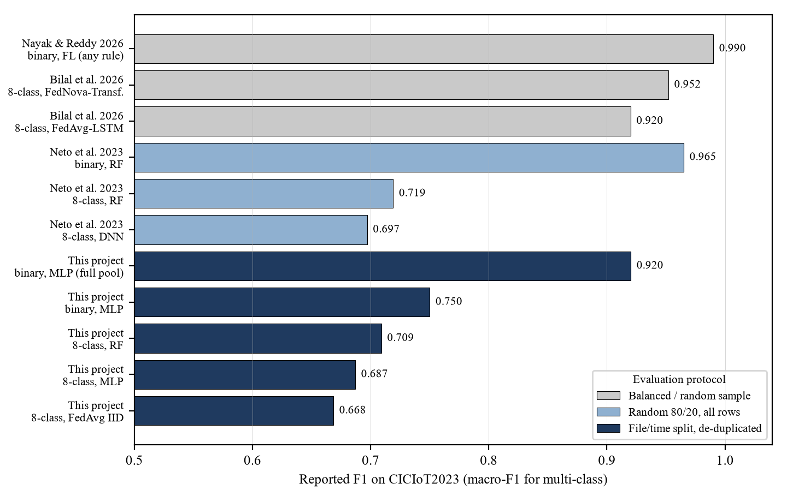
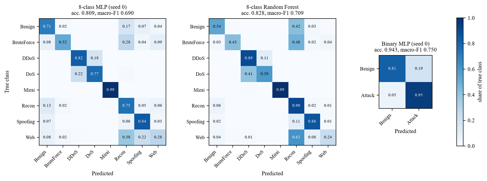

# AI-Enabled Cyberattack Detection and Adversarially Robust Federated Intrusion Detection {.unlisted}
### Technical report - Vinit Soni (E23CSEU0437) - final version, 14 November 2026

Every number in this report is produced by a script in this repository and stored in the file
named next to it. `reports/tables/*.csv` are generated by `scripts/make_figures.py` from
`artifacts/runs/*`. Nothing was copied from papers.

All Phase 2 results come from one GPU setup (RTX 3050, torch 2.14.1+cu130). Phase-1 CPU results are
archived in `artifacts/runs_cpu_20261026/`; CPU and GPU runs are not bit-identical.

Results are for one split of one dataset release. Seeds per cell are given in the `n_seeds` column of
each table; "± x" is the sample standard deviation over seeds.

**Status:** all experiments are complete: WP1 (federated baseline), WP2 (poisoning), the evasion reruns, WP3
(centralized v2 + calibrated operating points, §4.1), WP4 (federated v2, §5.3), the Flower deployment across Azure
and the laptop (§5.4), WP5 (evasion at fixed FPR + adversarial training, §7.1) and WP6 (GridStratLLM without the
ARP signature, §8.1). The 60-round convergence check (§5) and the deployed Azure model endpoint (§9) were
completed on 11 November; the real-traffic test (§4.2) on 14 November.

**Contents**

::: toc
:::

## 1. Scope and research questions
Four separate studies, each with its own threat model (`reports/threat_models.md`). Every CICIoT2023
study is run for three label sets:
* **8-class:** Benign + 7 attack families.
* **34-class:** individual attacks.
* **binary:** benign vs. attack.

| RQ | Question |
|---|---|
| RQ1 (detection) | How well do an MLP and a Random Forest detect CICIoT2023 attacks under a leakage-aware split? |
| RQ2 (federation) | How do FedAvg and FedProx compare with centralized training under IID and Dirichlet label-skewed clients? |
| RQ3 (poisoning) | How much do malicious clients' manipulated updates harm the global model? Do median, trimmed-mean and norm-clipping aggregation help, and at what clean cost? |
| RQ4 (evasion) | Under a black-box attacker that can only pad, slow down and re-TTL its own packets, how many detected attack windows can be made to look Benign? |
| RQ5 (LLM-coordinated attacks) | On GridStratLLM, do network signatures of LLM-planned attacks transfer to sessions planned by a held-out LLM? |

**Not claimed:**
* Novel algorithms.
* Formal privacy: no DP, no secure aggregation.
* Anything about CIC-IDS2017 / UNSW-NB15.
* Transfer between CICIoT2023 and GridStratLLM (never merged).

### 1.1 Changes since the Phase 1 proposal (16 October 2026)
The scope and threat models are unchanged; the research questions were reordered and sharpened after the data
audit (`reports/phase1_review.md`).

| Phase 1 research question | In this report | What changed |
|---|---|---|
| 1. How well does a baseline IDS detect CICIoT2023 attacks? | RQ1, §4-4.1 | Added calibrated 1 % / 5 % FPR operating points, a tuned v2 MLP and HGB |
| 2. Can GridStratLLM metadata support a separate evaluation of LLM-coordinated attacks? | RQ5, §8-8.1 | Answered yes; tested by leave-one-LLM-out, plus a follow-up without the ARP signature |
| 3. How much does constrained evasion degrade macro-F1 and minority-class recall? | RQ4, §7-7.1 | Measured as per-family evasion rate and attack recall after the attack (§7 explains why); adversarial training added as a defence |
| 4. How much damage does poisoning cause under IID / non-IID clients, and can a selected defence reduce it? | RQ3, §6 | Three robust aggregators instead of one, two attacks, and a malicious-fraction sweep |
| 5. Performance, false-positive, runtime and communication trade-offs | Throughout | FPR at fixed operating points (§4.1), communication and rounds (§5.3), defence runtime (§6) |
| (new) Federated vs centralized training | RQ2, §5-5.4 | Added because the poisoning study needs a measured federated baseline first; includes a real Flower run across Azure and the laptop |

**Other additions:** every CICIoT2023 study is run for three label sets (8-class, 34-class, binary), a local
demo dashboard (§9) shows detection and the evasion attack live, and the detectors were tested on real captured
traffic that contains no attacks (§4.2).

**Planned but not done:**
* The optional synthetic-traffic source (Knowledge-to-Data, arXiv:2601.05022) was not used.
* The commercial NSM alerts in GridStratLLM could not be scored (clock offset, §2).
* WP6 window-size and guard-band sensitivity was left as future work.

### 1.2 Comparison with published work
The four closest studies were read in full; the detailed review is `reports/literature_review.md`.

| | Neto 2023 | Bilal 2026 | Nayak & Reddy 2026 | Kampourakis 2026 | **This project** |
|---|---|---|---|---|---|
| Dataset | CICIoT2023 | 3 IoT/IIoT sets | 3 IoT sets | AWID3 (synthetic) | CICIoT2023 + GridStratLLM |
| Split | Random 80/20 | Balanced test | Random, balanced | Synthetic → real | File/time, de-duplicated |
| Federated | No | 3 algorithms | 5 aggregators | No | FedAvg, FedProx + Flower on Azure |
| Poisoning | No | No | Yes, 5-45 % sweep | No | Yes, 10-30 % sweep, targeted + untargeted |
| Evasion | No | No | No | No | Yes, + adversarial training |
| LLM attacks | No | No | No | LLM-generated data | LLM-planned attacks |
| Fixed FPR | No | No | No | No | 5 % and 1 % |
| Seeds | 1 | 1 | 3-5 + tests | 1 | 3 (main cells) |

| Study | Task | Protocol | Reported F1 |
|---|---|---|---|
| Neto et al. 2023 | 8 classes, RF / DNN | Random 80/20 | 0.719 / 0.697 |
| Neto et al. 2023 | binary, RF / DNN | Random 80/20 | 0.965 / 0.940 |
| Bilal et al. 2026 | 8 classes, FL | Device-group clients, balanced test | 0.920-0.952 |
| Nayak & Reddy 2026 | binary, FL | Balanced sample, α = 0.3 | 0.989-0.990 |
| **This project** | 8 classes, MLP / RF | File/time split, de-duplicated | **0.687 / 0.709** |
| **This project** | binary, MLP | same; whole test pool at natural prior | **0.750; 0.920** |
| **This project** | 8 classes, FedAvg IID / α = 0.1 | same, federated | **0.668 / 0.423** |

* **Multi-class results agree with the dataset's authors.** This project's 8-class macro-F1 is within 0.01-0.03
  of Neto et al.'s own benchmark, although its split is stricter.
* **The 0.92-0.99 results come from easier protocols.** They use balanced or random samples, which hide the
  benign class. The binary MLP rises from 0.750 to 0.920 when scored at the natural class prior.
* **Poisoning results agree with Nayak and Reddy where the settings match.** FedAvg collapses, and coordinate-wise
  rules hold only within their assumptions and weaken with non-IID clients.
* **No reviewed study evaluates evasion, a fixed false-positive rate, or LLM-planned attacks.**

## 2. Data and data quality (`reports/dataset_audit.md`)
* **CICIoT2023 local release:**
  * 309 CSV files, 46,776,700 windows, 39 features.
  * No label column: labels come from folder names, validated against traffic content.
  * Exact audit reproduced against an earlier run, with checksums.
* **Quality findings that shape the method:**
  * 55.0 % of rows are exact duplicates.
  * 30.6 % of rows share their exact feature vector with a row of another class (mostly DDoS-X vs DoS-X).
  * `Number` and five related features encode the per-family extraction window (100 vs 10 packets).
  * Rows are time-ordered within files.
* **GridStratLLM:**
  * BagIt archive verified (14/14 MD5).
  * 436 attack sessions from 4 LLMs (5 attack datasets) + 1.75 h of normal operation.
  * Packet labels are incomplete, and the commercial NSM's clock cannot be aligned with the capture.

## 3. Method
* **Split** (`artifacts/splits/ciciot_v1/split_manifest.json`):
  * File-level for classes with >= 3 capture files; purged time blocks (70/15/15) for the 17 classes with 1-2 files.
  * Within-split de-duplication, then per-class caps.
  * Working sets: train 664,187 / val 132,923 / test 253,328.
  * The whole test pool (8,980,013 windows, natural prior) is also scored.
  * 12.2 % of test vectors also occur in the train pool; "unseen" metrics exclude them.
* **Preprocessing** (fitted on train only): +-inf -> NaN, median imputation, signed log, standardisation.
  33 window-invariant features (the all-39 set is an ablation).
* **Model:**
  * MLP 33-128-64-K, 13,128 parameters for K = 8. Adam lr 1e-3, batch 512, sqrt-inverse class weights.
  * Early stopping on validation macro-F1 (patience 5, <= 30 epochs).
  * Baseline: Random Forest (100 trees, balanced-subsample weights).
* **Federated simulation** (`federated/simulation.py`):
  * 10 clients, all clients every round, 30 rounds, 1 local epoch.
  * Partitions: IID, Dirichlet α = 1.0, Dirichlet α = 0.1. Algorithms: FedAvg, FedProx μ = 0.01 (μ ∈ {0.001, 0.1, 1} checked once).
  * Same model, preprocessing and test set as centralized training.
  * Communication = float32 model broadcast + upload per client per round.
* **Hardware:** Ryzen 5 5600H, 15.3 GB RAM, RTX 3050 Laptop (4 GB), Python 3.14.6, torch 2.14.1+cu130.

## 4. Centralized baseline (RQ1) - `reports/tables/m4_centralized.csv`, `m4_per_class_test.csv`

| Task | Model | Test macro-F1 | per seed | Balanced acc. | Unseen | Benign FPR | Full test pool macro-F1 |
|---|---|---|---|---|---|---|---|
| 8-class | MLP (3 seeds) | **0.687 ± 0.005** | 0.690 / 0.690 / 0.681 | 0.710 | 0.691 | 0.264 | 0.606 (seed 0) |
| 8-class | Random Forest | 0.709 | - | 0.680 | 0.715 | 0.464 | 0.607 |
| 8-class, all 39 feat. (ablation) | MLP / RF | 0.696 / 0.712 | - | 0.708 / 0.684 | 0.700 / 0.719 | 0.282 / 0.463 | 0.624 / 0.609 |
| 34-class | MLP (3 seeds) | **0.556 ± 0.027** | 0.569 / 0.525 / 0.573 | 0.571 | 0.558 | 0.262 | 0.535 |
| 34-class | Random Forest | 0.591 | - | 0.594 | 0.593 | 0.285 | 0.541 |
| binary | MLP (3 seeds) | **0.750 ± 0.004** | 0.750 / 0.746 / 0.754 | 0.879 | 0.748 | 0.192 | 0.920 |
| binary | Random Forest | 0.747 | - | 0.703 | 0.746 | **0.586** | 0.785 |

**Results matrix with accuracy** (from `artifacts/runs/*/metrics_*.json`; full pool = whole test pool at the
natural class prior, seed 0 for the MLP):

| Task | Model | Accuracy | Macro-F1 | Balanced acc. | Benign FPR | Full pool: acc. / macro-F1 |
|---|---|---|---|---|---|---|
| 8-class | MLP (3 seeds) | 0.807 | 0.687 ± 0.005 | 0.710 | 0.264 | 0.772 / 0.606 |
| 8-class | Random Forest | 0.828 | 0.709 | 0.680 | 0.464 | 0.786 / 0.607 |
| 34-class | MLP (3 seeds) | 0.688 | 0.556 ± 0.027 | 0.571 | 0.262 | 0.739 / 0.535 |
| 34-class | Random Forest | 0.722 | 0.591 | 0.594 | 0.285 | 0.714 / 0.541 |
| binary | MLP (3 seeds) | 0.943 | 0.750 ± 0.004 | 0.879 | 0.192 | 0.990 / 0.920 |
| binary | Random Forest | 0.969 | 0.747 | 0.703 | 0.586 | 0.980 / 0.785 |

**Per-class test results, 8-class** (MLP mean of 3 seeds; `reports/tables/m4_per_class_test.csv`):

| Class | MLP precision | MLP recall | MLP F1 | RF F1 | Test windows |
|---|---|---|---|---|---|
| Benign | 0.501 | 0.706 | 0.586 | 0.580 | 10,000 |
| BruteForce | 0.514 | 0.522 | 0.518 | 0.550 | 1,895 |
| DDoS | 0.909 | 0.821 | 0.863 | 0.872 | 107,571 |
| DoS | 0.618 | 0.771 | 0.686 | 0.629 | 40,000 |
| Mirai | 0.998 | 0.993 | 0.996 | 0.996 | 30,000 |
| Recon | 0.854 | 0.749 | 0.798 | 0.841 | 40,328 |
| Spoofing | 0.820 | 0.838 | 0.829 | 0.888 | 20,000 |
| Web | 0.213 | 0.282 | 0.242 | 0.317 | 3,534 |

**Reading the confusion matrices.**

* **DDoS and DoS are confused with each other** (18-22 % for the MLP, 11-41 % for the RF). Each DDoS attack has a
  single-source DoS counterpart, and most of the 30.6 % of raw rows that share their feature vector with another
  class are such DDoS-X/DoS-X pairs (§2). DDoS and DoS are also the two largest classes, which is why accuracy is
  so much higher than macro-F1.
* **Web and Brute force are mostly predicted as Recon** (Web 0.38 MLP / 0.62 RF; Brute force 0.28 / 0.48). These
  are low-rate attacks embedded in ordinary-looking traffic.
* **Benign windows are flagged mainly as Recon** (0.17 MLP, 0.42 RF): the false-alarm problem that the calibrated
  thresholds in §4.1 address.
* **Mirai is almost perfect** (0.99) for both models.
* The same pattern appears in the dataset authors' own confusion matrices (Neto et al., 2023, Tables 7-8), where
  Web and Brute force fall into Benign, Recon and Spoofing.

* **Accuracy flatters the models; macro-F1 is far lower.** In the 8-class task, DDoS and Mirai are easy, while Web and BruteForce are poor (per-class table).
* **Benign is the hard class in every task.** 19-29 % of benign windows are flagged (MLP), mostly as Recon, Spoofing or Web, which embed attacks in normal-looking traffic. At these argmax operating points no configuration is deployable; §4.1 fixes the operating point.
* **The Random Forest wins macro-F1 only by over-flagging.** In 8-class and binary its benign FPR is 2-3x the MLP's, so "better" depends on the operating point.
  Balanced accuracy (mean per-class recall, which weights Benign like every other class) reverses the ranking:
  8-class MLP 0.710 vs RF 0.680, binary 0.879 vs 0.703. Only on 34-class is the RF ahead on both metrics.
* **The 34-class MLP is unstable across seeds** (0.525-0.573). Seed 1 stopped early. Results for that task need more seeds or tuning.
* **Shortcut ablation.** The six window-dependent features add <= +0.01 macro-F1.
* **Leakage check.** Unseen-test metrics are within 0.006 of all-test metrics.
* **Natural class prior.** Full-pool macro-F1 drops to 0.61 in the 8-class task because benign false positives swamp the precision of small classes. It *rises* to 0.92 in the binary task, where the attack class dominates the pool.
* These numbers are far below the >0.99 often quoted for CICIoT2023. That is expected from file/time-aware splitting and de-duplication; published protocols differ.

### 4.1 Centralized v2 and calibrated operating points (WP3) - `reports/tables/wp3_*.csv`
**Protocol.** Everything was selected on validation; the test split was loaded once, after freezing.
* **Search** (`experiments/hparam_search.py`, `configs/hparam_search.yaml`): hidden {128-64, 256-128, 256-128-64}
  x lr {1e-3, 3e-4} x class weighting {sqrt-inverse, inverse} x dropout {0.1, 0.3} = 24 configs per task, seed 0,
  <= 50 epochs. The top 3 per task were re-run with seeds 1-2; v2 = best 3-seed mean val macro-F1.
* **Operating points** (`evaluation/calibration.py`): attack score = 1 - P(Benign); the threshold is the value that
  flags at most 5 % (or 1 %) of benign validation windows. Above it, the window gets the most probable attack class.
* **Candidates** (`experiments/wp3_detectors.py`): v1 MLP, v2 MLP, Random Forest, HistGradientBoosting (HGB,
  untuned, balanced class weights), and a two-stage detector (binary v2 MLP, then an attack-only MLP).
* **Frozen** (`experiments/wp3_freeze.py`, `artifacts/runs/centralized_v2/`): v2 MLP and HGB. Before scoring test,
  each validation threshold was re-derived and checked against the model-selection value.

**v2 configuration.** 256-128 hidden units, sqrt-inverse weights, dropout 0.1; lr 1e-3 (8-class, 34-class) and
3e-4 (binary). Val macro-F1, 3 seeds: 0.691 ± 0.003 / 0.587 ± 0.002 / 0.764 ± 0.002 vs v1 0.686 / 0.569 ± 0.018 / 0.757.
Two seed-0 winners lost their place after the re-check, so one seed would have picked the wrong config.

Test attack detection at the 5 % / 1 % validation thresholds (achieved test benign FPR in brackets; MLP = mean of 3 seeds):

| Task | v1 MLP | v2 MLP | HGB | Random Forest |
|---|---|---|---|---|
| 8-class | 0.894 / 0.849 (5.5 / 1.2 %) | 0.893 / 0.852 (5.0 / 1.3 %) | **0.902 / 0.862** (4.6 / 1.0 %) | 0.904 / 0.841 (4.6 / 0.9 %) |
| 34-class | 0.889 / 0.844 (5.0 / 1.2 %) | 0.892 / 0.846 (4.8 / 1.0 %) | 0.901 / 0.849 (4.3 / 0.9 %) | **0.909 / 0.854** (5.5 / 1.2 %) |
| binary | 0.886 / 0.826 (4.8 / 1.0 %) | 0.890 / 0.833 (4.9 / 1.0 %) | **0.914 / 0.861** (4.5 / 0.7 %) | 0.903 / 0.824 (4.4 / 0.8 %) |

* **The operating point matters more than the model.** At argmax the MLPs flag 19-26 % of benign test windows.
  At the 1 % threshold they flag 1.0-1.3 % and still detect 83-85 % of attack windows.
* **Calibration transfers.** The achieved test FPR is 4.3-5.5 % at the 5 % target and 0.7-1.3 % at the 1 % target.
  The MLPs overshoot slightly on 8-class (1.2-1.3 %). Test values track validation within ~0.01.
* **Tuning helps only a little.** v2 gains 0.3-0.7 points of detection over v1 at 1 % FPR. The clear gains
  are 34-class macro-F1 (test 0.574 vs 0.556 at argmax) and stability (seed sd 0.002 vs 0.018 on val).
  Validation binary ROC-AUC was 0.97-0.975 for almost every config.
* **Class weighting was the only strong factor.** sqrt-inverse beat inverse by 0.02-0.11 val macro-F1 in every task.
* **HGB is the best detector at 1 % FPR** on binary (+2.8 points over v2) and 8-class, and trains in 7-47 s.
  On 34-class the Random Forest is marginally better (single seed each).
* **Negative result: the two-stage detector** detects exactly what its binary stage detects (by construction).
  It assigns the family/attack less well than a single model (val macro-F1 at 1 %: 0.581 vs 0.608 on 8-class).
* **Natural class prior.** On the full test pool (8.98 M windows, seed 0), every detector detects 98.5-98.9 % of
  attack windows at the 1 % threshold, because easy flood windows dominate the pool. Binary F1 at 1 %: HGB 0.925,
  v2 0.909, v1 0.903. The pool's macro-F1 stays near 0.60 (8-class) and 0.53 (34-class).
* **Caveat.** These are per-window rates. On a busy network, 1 % of benign windows can still mean many alerts;
  alert aggregation was not evaluated.

### 4.2 Real traffic: does the detector transfer? - `reports/tables/live_capture.csv`, `live_recalibration.csv`
CICIoT2023's test split comes from the same lab as its training data. To test the detectors on traffic they have
never seen, two captures that contain **no attacks** were scored with the demo bundle's models (frozen v2 MLP and
WP5-hardened MLP, 8-class). Every alarm on them is therefore a false alarm.

* **Laptop.** 10 minutes of the author's own laptop on home Wi-Fi (Wireshark 4.6.9 / Npcap 1.88, 14 November 2026):
  browsing Wikipedia, BBC News and GitHub, then a YouTube video. 59,586 packets, none dropped, 5,958 windows. The
  capture stays outside the repository because it contains addresses; only aggregate numbers are reported.
* **Smart grid.** GridStratLLM normal operation (`20260225_normal`): 2.15 M packets of S7 traffic, 212,407 windows.

`python -m federated_ids.live.score <capture>` reads pcap/pcapng and computes the CICIoT2023 window features. The
dataset's extractor is not public without registration, so each definition was derived from the benign CSVs and
checked against them (`src/federated_ids/live/features.py`; e.g. `Protocol Type` is the window's most common
protocol, `Std` the sample standard deviation). The analysis is `python scripts/live_analysis.py`.

| Capture | Model | Windows | Alarms at argmax | 5 % rule | 1 % rule | 1 % rule, TCP windows | 1 % rule, UDP (QUIC) windows |
|---|---|---|---|---|---|---|---|
| Laptop | frozen | 5,958 | 99.6 % | 96.7 % | **88.6 %** | 70.0 % | 99.1 % |
| Laptop | hardened | 5,958 | 100.0 % | 95.5 % | **85.5 %** | 62.5 % | 98.2 % |
| Smart grid | frozen | 212,407 | 100.0 % | 100.0 % | **99.9 %** | 99.9 % | - |
| Smart grid | hardened | 212,407 | 100.0 % | 97.4 % | **35.5 %** | 35.5 % | - |

(Windows count as TCP or UDP if at least half of their packets are; the smart-grid capture has 12 UDP windows.)

* **The detectors do not transfer.** The 1 % rule, which flags 1.2 % of benign windows on the CICIoT2023 test
  split, flags 86-89 % of the laptop's windows, mostly as Spoofing.
* **QUIC is the largest gap.** 64 % of the laptop's windows are UDP: HTTPS over UDP port 443 (HTTP/3, mostly the
  video). 98-99 % of them are flagged. CICIoT2023's benign windows are 10 % UDP at the median, and HTTP/3 is
  essentially absent from them.
* **Ordinary TCP browsing is flagged too** (62-70 %): a Windows laptop on a home network is not one of the
  dataset's lab IoT devices.
* **The capture method explains little.** Npcap timestamps Wi-Fi packets in bursts, so the median `Rate` is
  1.0 M packets/s against 172 in the dataset's benign traffic. Replacing `Rate` and `IAT` with the training median
  lowers the laptop's alarm rate only to 84.7 % (both models).
* **Industrial traffic is further still.** S7 traffic has no HTTPS, a PSH share of 0.6 (benign 95th percentile: 0.5)
  and frames of at most 241 bytes at the median. The frozen model flags 99.9 % of it; the hardened model 35.5 %.

**Can recalibration fix it?** A local threshold was fitted so that 1 % of the first five minutes of the laptop
capture is flagged, then tested on the last five minutes (54 % and 74 % UDP windows respectively):

| Model | Threshold | Laptop false alarms (last 5 min) | CICIoT2023 test benign FPR | CICIoT2023 test attack detection |
|---|---|---|---|---|
| frozen | validation 1 % (CICIoT2023) | 90.6 % | 1.2 % | 85.5 % |
| frozen | local 1 % (first 5 min of laptop) | 5.4 % | 0.0 % | 59.3 % |
| hardened | validation 1 % (CICIoT2023) | 87.2 % | 1.2 % | 85.4 % |
| hardened | local 1 % (first 5 min of laptop) | 0.1 % | 0.0 % | 53.0 % |

* **A threshold cannot repair a feature-space gap.** The local threshold removes most false alarms, but it has to
  sit within 10^-8^ of 1 (the models are near-certain the laptop's traffic is an attack). At that threshold the
  detectors miss 41-47 % of the CICIoT2023 test attacks instead of 15 %.
* **What would fix it** is local benign traffic in training. That is what federated learning with clients on the
  deployment networks provides (§5), subject to the label-skew limits found there.
* **Scope.** One laptop, one network, 10 minutes; the dataset's 10-packet windows; false alarms only (no attacks
  were generated). The result is a lower bound on how far lab results can be from deployment, not a measurement
  of deployment performance.

## 5. Federated learning (RQ2) - `reports/tables/m5_federated.csv`, `reports/figures/m5_convergence_*.png`

Test macro-F1, mean ± sd over 3 seeds (benign FPR in brackets):

| Setting | 8-class | 34-class | binary |
|---|---|---|---|
| Centralized | 0.687 ± 0.005 (0.26) | 0.556 ± 0.027 (0.26) | 0.750 ± 0.004 (0.19) |
| FedAvg, IID | 0.668 ± 0.001 (0.28) | 0.520 ± 0.001 (0.30) | 0.741 ± 0.000 (0.18) |
| FedProx, IID | 0.667 ± 0.001 (0.29) | 0.512 ± 0.003 (0.31) | 0.740 ± 0.001 (0.18) |
| FedAvg, Dirichlet α=1.0 | 0.667 ± 0.008 (0.29) | 0.514 ± 0.007 (0.31) | 0.758 ± 0.001 (0.28) |
| FedProx, Dirichlet α=1.0 | 0.664 ± 0.009 (0.29) | 0.508 ± 0.006 (0.32) | 0.757 ± 0.002 (0.27) |
| FedAvg, Dirichlet α=0.1 | **0.423 ± 0.107** (0.60) | **0.425 ± 0.027** (0.61) | **0.632 ± 0.137** (0.69) |
| FedProx, Dirichlet α=0.1 | 0.469 ± 0.106 (0.57) | 0.426 ± 0.026 (0.66) | 0.640 ± 0.128 (0.68) |

* **Moderate heterogeneity costs little.** With IID or α = 1.0 clients, FL is 0.02 (8-class) to 0.04 (34-class) macro-F1 below centralized after 30 rounds.
* **Binary α = 1.0 is not a real gain.** Its higher macro-F1 (0.758 vs 0.750) comes with a much higher benign FPR (0.28 vs 0.19), i.e. a different operating point.
* **Strong label skew (α = 0.1) breaks training in all three tasks.** Macro-F1 drops by 0.12-0.26, the benign FPR more than doubles, and results vary strongly with the seed (sd up to 0.14).
* **More rounds do not fix it either** (convergence check, `reports/tables/m5_r60_convergence.csv`,
  `reports/figures/m5_r60_convergence.png`). FedAvg was re-run for 60 rounds: IID seed 0 and α = 0.1 seeds 0-2, all
  three tasks. Round 30 of every 60-round run equals the 30-round run exactly, so the extra rounds are a clean
  continuation.
  * IID was close to its plateau: rounds 30 -> 60 add +0.003 (binary), +0.010 (8-class) and +0.013 (34-class)
    macro-F1. The 30-round numbers therefore slightly understate IID FL (e.g. 8-class 0.679 at round 60 vs 0.687
    centralized).
  * α = 0.1 changes by -0.050 to +0.021 and stays at 0.31-0.51 (8-class), 0.41-0.46 (34-class) and 0.49-0.76 (binary).
    At round 60, 6 of the 9 skewed runs still flag >= 80 % of benign windows, and binary seed 0 gets worse
    (0.642 -> 0.592). The only good skewed run (binary seed 2, 0.763) was already good at round 30.
  * So the α = 0.1 failure is not under-training; it comes from the label skew itself.
* **FedProx does not fix it.**
  * Its mean gain at α = 0.1 is +0.05 (8-class), +0.001 (34-class) and +0.008 (binary). All are well inside one standard deviation.
  * The single-seed μ check found no better μ than 0.01. Larger μ made binary and 34-class worse. For 34-class, all three extra μ values gave a model that flags essentially every benign window (benign FPR >= 0.9997).
* **Cost per run** (30 rounds, 10 clients):
  * Communication: 30.05 MB (8-class), 33.92 MB (34-class), 29.15 MB (binary).
  * Wall clock: ~84-117 s on the GPU (`wall_clock_s`).

### 5.3 Federated v2 and realism checks (WP4) - `reports/tables/wp4_federated.csv`
* **Setup.** The simulator was re-run with the v2 MLP (§4.1) for each task.
  * Main cells: {IID, α = 1.0, α = 0.1} x FedAvg x 3 seeds.
  * Realism variants (IID and α = 1.0, seed 0 only): 50 % client participation, 20 clients, 2 local epochs.
* **Scoring** (`experiments/wp4_eval.py`). Every clean FedAvg run, v1 (M5) and v2, is scored like §4.1:
  thresholds at 5 % / 1 % benign FPR fitted on validation, then applied unchanged to test.
  Convergence = first round whose val macro-F1 reaches 95 % of the centralized v2 val macro-F1.

Test attack detection at the 1 % threshold (mean of 3 seeds; achieved FPR 1.0-1.4 %) and argmax macro-F1:

| Setting | 8-class v1 -> v2 | 34-class v1 -> v2 | binary v1 -> v2 |
|---|---|---|---|
| Centralized | 0.849 -> 0.852 | 0.844 -> 0.846 | 0.826 -> 0.833 |
| FedAvg IID | 0.839 -> 0.843 (F1 0.668 -> 0.676) | 0.823 -> 0.840 (F1 0.520 -> 0.534) | 0.816 -> 0.808 (F1 0.741 -> 0.737) |
| FedAvg α = 1.0 | 0.837 -> 0.843 (F1 0.667 -> 0.672) | 0.816 -> 0.834 (F1 0.514 -> 0.528) | 0.808 -> 0.803 (F1 0.758 -> 0.754) |
| FedAvg α = 0.1 | 0.803 -> 0.811 (F1 0.42 -> 0.45, sd 0.11) | 0.801 -> 0.815 (F1 0.42 -> 0.45) | 0.53 -> 0.53 (sd 0.46) |
| Communication / 30 rounds | 30.1 -> 97.6 MB | 33.9 -> 105.3 MB | 29.2 -> 95.8 MB |

* **v2 helps federated training more than centralized training on 34-class.** It adds +1.6-1.8 points of detection
  at 1 % FPR and +0.014 macro-F1. Federated v2 comes within 0.4 points of centralized v1 at 1 % FPR (0.840 vs 0.844).
* **On binary, v2 is slightly worse** (-0.5 to -0.8 points). v2's binary learning rate (3e-4) was chosen centrally.
  A plausible cause, not tested, is that it is too slow for one local epoch per round.
* **The federated gap at a fixed FPR is small:** 0.9 (8-class), 0.6 (34-class) and 2.5 (binary) points of detection
  below centralized v2 (IID).
* **Strong label skew (α = 0.1) remains unsolved** for both architectures.
* **Cost.** v2 has 3.2x the parameters (41.9 k vs 13.1 k), so it needs 3.2x the communication. 34-class FL does not
  reach 95 % of centralized v2 val macro-F1 within 30 rounds (one exception below).

Realism variants (v2, seed 0; test detection at 1 % FPR, IID / α = 1.0):

| Variant | 8-class | 34-class | binary | Communication | Rounds to 95 % (8-class IID) |
|---|---|---|---|---|---|
| Base (10 clients, all, 1 epoch) | 0.846 / 0.844 | 0.839 / 0.833 | 0.804 / 0.805 | 1x | 14 |
| 2 local epochs | **0.850 / 0.846** | **0.846 / 0.844** | **0.819 / 0.816** | 1x (2x client compute) | 8 |
| 50 % participation | 0.844 / 0.846 | 0.837 / 0.835 | 0.808 / 0.801 | **0.5x** | 16 |
| 20 clients | 0.832 / 0.831 | 0.812 / 0.812 | 0.798 / 0.804 | 2x | 26 |

* **2 local epochs is the best trade** when client compute is cheap.
  * Same communication, up to +1.4 points of detection, and 95 % is reached in about half the rounds.
  * It is the only setting in which 34-class reaches 95 % (IID, round 30).
* **Sampling half the clients each round halves communication** at <= 0.4 points of detection.
* **20 clients (half the data each) costs up to 2.7 points of detection** and doubles communication.
  The cost is largest on 34-class (2.1-2.7) and smallest on binary (0.1-0.7). More,
  smaller clients is the realistic direction, so this cost should be expected in deployment.
* These variants are single-seed. Base-cell seed sd is <= 0.005 at IID / α = 1.0, so gaps of >= 0.01 are likely real
  and smaller ones are not established.

### 5.4 Flower deployment across Azure and the laptop - `artifacts/runs/flower_azure_hybrid_category_iid_s0/`
* **Implementation.** `flower_app/` runs the simulator's model, data and partitions with Flower 1.42 as real
  processes: 1 SuperLink and N SuperNodes, CPU clients.
  * Memory fix: each client loads only its own preprocessed partition (`federated/export_partitions.py`, ~1.8 MB per
    client). The first 10-client attempt had run out of memory because every client loaded all splits.
  * Local check: 10 SuperNodes x 2 rounds reproduce the simulator (test macro-F1 0.5958 vs 0.5961).
* **Hybrid run** (8-class, IID, FedAvg, seed 0, 30 rounds):
  * SuperLink on an Azure VM (Standard_B2s_v2, indiasouthcentral).
  * 5 SuperNodes on a second Azure VM and 5 on the laptop, so training crossed the internet over TLS.
  * Inbound access to the VMs was SSH only, restricted to the operator's IP addresses.

| | Flower (Azure + laptop) | Simulator (same seed/partition) |
|---|---|---|
| Test macro-F1 | 0.6692 | 0.6692 |
| Benign FPR | 0.286 | 0.294 |
| Attack detection | 0.965 | 0.966 |
| Unseen macro-F1 | 0.6734 | 0.6734 |
| Wall clock | 561 s | ~92 s (GPU) |

* **The distributed run reproduces the simulator** to four decimals in macro-F1. The small FPR difference comes from
  CPU vs GPU arithmetic. The simulator results in §5-6 therefore stand for a real deployment of this setup.
* The deployment is ~6x slower, from network round trips and CPU clients. Communication was 30.05 MB, as estimated.
* **Rehearsal before the final demo (2026-11-11).** The same setup was re-run for 2 rounds
  (`artifacts/runs/flower_azure_rehearsal_20261111/`): 10 of 10 clients replied in each round with 0 failures, 51 s,
  test macro-F1 0.5960 after round 2 (simulator at round 2: 0.5961). Between the two runs, Windows Application
  Control on the laptop started blocking Flower's pip-generated launcher programs (`flwr.exe`,
  `flower-supernode.exe`, ...). The laptop now starts the same Flower entry points through `python.exe`
  (`scripts/azure/win_shim/`, `run_hybrid.sh`); code and arguments are unchanged.

## 6. Model-update poisoning (RQ3) - `reports/tables/m6_poisoning.csv`, `reports/figures/m6_poisoning_*.png`

Setup:
* 2 of 10 clients malicious (20 %), fixed seeded choice. All 30 rounds.
* IID: 3 seeds. Dirichlet α = 1.0: seed 0 only.
* "DDoS->B" = share of DDoS-family test windows predicted Benign. It is 0.001-0.003 without an attack in every cell.

**IID clients, test macro-F1 (DDoS->B in brackets):**

| Attack | Aggregator | 8-class | 34-class | binary |
|---|---|---|---|---|
| none | FedAvg | 0.668 | 0.520 | 0.741 |
| none | Median / Trimmed / Norm clip | 0.668 / 0.668 / 0.669 | 0.520 / 0.520 / 0.520 | 0.740 / 0.741 / 0.742 |
| sign-flip x5 | FedAvg | **0.008** | **0.003** | **0.038** |
| sign-flip x5 | Median / Trimmed / Norm clip | 0.666 / 0.666 / 0.661 | 0.513 / 0.512 / 0.504 | 0.738 / 0.739 / 0.738 |
| DDoS->Benign + boost | FedAvg | 0.502 (**0.62**) | 0.396 (**0.23**) | 0.533 (**0.39**) |
| DDoS->Benign + boost | Median / Trimmed / Norm clip | 0.667 / 0.666 / 0.662 (<= 0.003) | 0.522 / 0.523 / 0.518 (<= 0.002) | 0.742 / 0.743 / 0.747 (<= 0.003) |

**Findings:**
* **Two malicious clients defeat plain FedAvg in every task.**
  * Untargeted sign-flip collapses the model to a single predicted class, so macro-F1 falls to 0.00-0.04.
  * The targeted attack hides 23-62 % (IID) and up to 73 % (binary, α = 1.0) of DDoS windows as Benign.
  * The targeted attack is **not stealthy**: macro-F1 falls and the benign FPR rises, which a server could notice.
* **In the IID case all three robust aggregators neutralise both attacks.** DDoS->B stays <= 0.003, and macro-F1 is within 0.016 of clean. The clean-utility cost is <= 0.001.
* **Runtime cost of the defences is negligible here.** Every aggregator takes 92-94 s per 30-round run (IID,
  `wall_clock_s`), the same as FedAvg. With 10 clients and 13 k parameters, aggregation is a tiny part of a round;
  the coordinate-wise median and trimmed mean grow with clients x parameters, so this does not carry over to large
  models or many clients.
* **With non-IID clients (α = 1.0, 1 seed) protection is partial:**
  * Macro-F1 stays near clean, but sign-flip still raises the benign FPR, from 0.31-0.33 to 0.42-0.50 (8-class) and from 0.29-0.32 to 0.44-0.48 (34-class).
  * Clean-run cost is also higher. For binary, median 0.733 vs FedAvg 0.757.
* **Attack strength depends on the attackers' data.**
  * Under α = 1.0 (8-class) the targeted attack reached only 1.6 % DDoS->B. In that partition the two malicious clients held 6.7 % of all DDoS rows, against 20 % under IID (`metrics.json` label histograms).
  * This is a confound, not robustness of FedAvg.
* **Malicious-fraction sweep (IID, seed 0) shows the expected assumption boundary.**
  * At 10 %, FedAvg already loses 0.02-0.03 macro-F1 under sign-flip and 0.11-0.15 under targeted poisoning, while median / trimmed mean hold.
  * At **30 % (3 of 10 clients), the trimmed mean (β = 0.2 trims only 2 values per side) fails partially**. Sign-flip: 8-class 0.477 with benign FPR 0.77; 34-class 0.364. Targeted: DDoS->B rises to 0.007-0.023.
  * The **median still holds at 30 %** (8-class 0.665 / 0.663; m = 3 < K/2).
  * This matches the threat model in `reports/threat_models.md` §B; the defence is only as good as its assumption about m.

## 7. Inference-time evasion (RQ4) - `reports/tables/m7_evasion.csv`, `reports/figures/m7_evasion_*.png`

Setup:
* Black-box, label-only attacker, <= 112 queries per window.
* The attacker may pad its own packets (<= MTU), slow down by factor r, and set TTL to benign quantiles.
* Every success is re-checked: 0 constraint violations, and re-queried as Benign.
* Target models: MLP seed 0 and the RF, per task. Up to 3,000 detected windows per attack family.
* Metrics: Phase 1 planned to report the drop in macro-F1 and minority-class recall. The attacker only changes
  its own attack windows, so benign rows are unaffected and the damage is entirely a loss of attack recall. It is
  reported directly: the **evasion rate** (share of detected windows turned Benign) per family, and in §7.1 the
  **robust detection** (attack recall after the attack). Per family, robust detection is exactly the per-class
  recall Phase 1 asked for (`wp5_advtrain_per_family_fpr1.csv`).

| Task | Model | Clean benign FPR | Overall evasion, r >= 1 | r >= 0.1 | Most evadable families at r >= 0.1 |
|---|---|---|---|---|---|
| 8-class | MLP | 0.294 | 0.118 | 0.197 | Spoofing 0.40, Web 0.33, BruteForce 0.29, Recon 0.28 |
| 8-class | RF | 0.464 | 0.089 | 0.161 | Spoofing 0.49, Web 0.25 |
| 34-class | MLP | 0.240 | 0.155 | 0.233 | Spoofing 0.55, Web 0.47, Recon 0.33 |
| 34-class | RF | 0.285 | 0.194 | 0.260 | Spoofing 0.65, Web 0.47, Recon 0.40 |
| binary | MLP | 0.187 | 0.190 | 0.235 | Spoofing 0.56, Web 0.45, Recon 0.35 |
| binary | RF | **0.586** | 0.017 | 0.043 | Spoofing 0.16 |

* **Flood families are hard to evade** (DDoS, DoS, Mirai <= 0.01), with one exception: the 8-class GPU-trained MLP, where DDoS and DoS reach **0.06** at r >= 0.1. The earlier CPU-trained MLP gave <= 0.01, so this robustness is model-dependent.
* **Low-rate families evade often.** Spoofing, Web, Recon and BruteForce windows can be made to look Benign 20-65 % of the time (r >= 0.1); these are the families already confused with Benign without any attack.
* **Most successes need no slow-down** (no throughput cost for the attacker): 55-81 % of successful evasions used r = 1 for five of the six targets, but only 39 % for the binary RF. No single knob is enough alone (`m7_evasion_knob_ablation.csv`).
* **The binary RF's low evasion rate is not robustness.** It labels 59 % of benign traffic as attack. At a fixed benign FPR (§7.1) every detector is evadable, including the binary tree model.
* **Limitation:** perturbations are modelled in feature space from the feature definitions; they were not replayed through the CIC extractor.

### 7.1 Evasion at a fixed false-positive rate, and adversarial training (WP5) - `reports/tables/wp5_*.csv`, `reports/figures/wp5_advtrain_evasion.png`
**Protocol** (`experiments/wp5_advtrain.py`). The attacker and its constraints are unchanged from §7.
* **Targets:** the frozen v2 MLP (3 seeds) and HGB (1 seed) from §4.1, attacked at three decision rules: argmax and
  the validation thresholds for 5 % and 1 % benign FPR.
* **Adversarial training, 2 rounds:** attack the current model's 1 %-FPR rule on a fixed *train* sample
  (<= 20,000 attack windows per family), add every successful adversarial window with its true label to a
  cumulative pool, retrain from scratch (same preprocessing and hyperparameters), and re-fit the thresholds on val.
* **Evaluation:** every round's model is attacked adaptively (the attacker queries the *retrained* model) on one fixed
  test sample (<= 3,000 attack windows per family, identical for all models). Evasion rate = share of detected windows
  turned Benign; robust detection = share of all sampled attack windows still flagged after the attack.
* **Checks:** 0 constraint violations in all 108 attacked evaluations; every success re-queried.

Evasion rate at the loosest budget (r >= 0.1), 1 %-FPR rule, round 0 (frozen) -> 1 -> 2; robust detection
in brackets (round 0 -> 2). MLP = mean of 3 seeds (sd <= 0.032).

| Task | v2 MLP | HGB |
|---|---|---|
| 8-class | 0.359 -> 0.119 -> 0.122 (0.45 -> 0.62) | 0.445 -> 0.185 -> **0.083** (0.40 -> 0.67) |
| 34-class | 0.406 -> 0.157 -> **0.103** (0.41 -> 0.62) | 0.486 -> 0.174 -> 0.172 (0.35 -> 0.57) |
| binary | 0.240 -> 0.100 -> **0.090** (0.50 -> 0.59) | 0.328 -> 0.160 -> 0.121 (0.48 -> 0.63) |

* **Calibrated thresholds are easier to evade than argmax.** At round 0 the 1 %-FPR rule is evaded 1.1-2.1x as
  often as argmax (8-class MLP 0.36 vs 0.17, 34-class HGB 0.49 vs 0.27, binary HGB 0.33 vs 0.31). Lowering the false-alarm rate moves the
  threshold towards the attack side, so a smaller perturbation crosses it. The deployable operating point (§4.1)
  is the vulnerable one.
* **The §7 Random Forest result does not carry over.** At a fixed 1 % FPR the binary tree model (HGB) is evaded
  33 % of the time, more than the MLP (24 %). The RF's 4 % in §7 came from flagging 59 % of benign traffic.
* **One round of adversarial training removes most of the evasion:** a 2.0-3.0x reduction at 1 % FPR in every task and model. A second round helps
  8-class HGB, 34-class MLP and binary HGB further; it is flat for 8-class MLP and 34-class HGB. Evasion without any slow-down (r = 1) falls from 0.19-0.41 to 0.06-0.14.
* **Clean cost is negligible.** Over both rounds, at the 1 % rule, clean test detection changes by -0.011 to +0.005,
  macro-F1 by -0.010 to +0.010, and the achieved benign FPR stays at 0.9-1.25 % (HGB binary 0.7 % -> 1.1 %). Argmax macro-F1
  changes by <= 0.015.
* **What remains.** After two rounds, flood families are almost never evaded (DDoS, DoS, Mirai <= 0.06; exception:
  binary HGB Mirai 0.25). Spoofing (0.28-0.69) and Web (0.20-0.50) stay evadable for every model, because they are
  the families that already overlap with Benign (§4). Robust detection at 1 % FPR is still only 57-67 %.
* **Limitations.** The defence is evaluated against the *same* attacker it was trained on (adaptive to the new
  model, but the same perturbation space); a stronger or different attacker was not tested. HGB has one seed.
  Perturbations remain feature-space only (§7).

## 8. LLM-coordinated attacks - GridStratLLM (RQ5) - `reports/tables/m8_gridstrat*.csv`, `reports/figures/m8_gridstrat_auc.png`

Setup:
* 10-s windows. Positive = overlaps a session's execution interval; windows within 20 s of a session are excluded.
* Identity-free features. Leave-one-LLM-out; normal operation split in time (0.70 h held out).

| Held-out LLM | Zeek weird (AUC) | Binding (AUC) | Volume (AUC) | Volume+binding (AUC) | Session detection (volume) |
|---|---|---|---|---|---|
| claude-sonnet-4.6 | 0.722 | 0.995 | 0.996 | 0.997 | 1.00 |
| gemini-3.1-pro-preview | 0.913 | 0.991 | 1.000 | 1.000 | 1.00 |
| minimax-m2.5 | 0.610 | 0.985 | 0.976 | 0.991 | 1.00 |
| gpt-5.3-codex | 0.767 | 0.936 | 0.903 | 0.918 | 1.00 |

* **The planning LLM barely matters.** All 436 sessions execute through the same primitives (`arp_mitm` + S7/Modbus data modification), so the network signature is set by the toolkit.
* **A classical rule works as well as the models.** "IP address with more than one source MAC" flags 89-99 % of attack windows, with 0 false-alarm windows on held-out normal operation (resolution 1.4/h).
* **Limitations.**
  * Every attack uses ARP MITM, so attacks without a MITM step cannot be tested here (§8.1 removes the ARP features but not the MITM).
  * The normal hold-out is short (0.70 h).
  * Commercial NSM not evaluated (clock offset).
  * Smart-grid findings do not transfer to generic IoT without testing.

### 8.1 Detection without the ARP signature (WP6) - `reports/tables/wp6_gridstrat_no_arp.csv`, `reports/gridstrat/wp6_results.json`
**Question.** If an attacker hid the ARP/L2-L3 binding anomaly, would the attacks still be detectable?
`gridstrat/wp6_no_arp.py` keeps the §8 windows, labels, guard band, Random Forest and leave-one-LLM-out folds, and
changes only the features:
* **Timing/volume, no identities** (12): §8 volume minus the host counts (distinct source MACs / IPs). No ARP
  packets, no binding feature, no host counts.
* **Process data** (137): SCADA records (`process_data.parquet`: PV, wind, battery, demand, power flow, ~100
  records/s). Per window and numeric field: standard deviation, range and number of value changes, plus records
  per source. Absolute levels are left out because they follow weather and time of day, which differ between
  capture days.
* **Check:** the §8 volume folds were recomputed in the same script and match the stored results exactly.

| Held-out LLM | Timing/volume, no ARP: AUC / session det. / FA per h | Process data only: AUC / session det. / FA per h | Both: AUC / session det. / FA per h |
|---|---|---|---|
| claude-sonnet-4.6 | 0.993 / 1.00 / 0 | 0.501 / 0.83 / 96.8 | 0.980 / 1.00 / 0 |
| gemini-3.1-pro-preview | 0.996 / 1.00 / 0 | 0.373 / 0.54 / 129.5 | 0.997 / 1.00 / 0 |
| minimax-m2.5 | 0.969 / 1.00 / 1.4 | 0.545 / 0.94 / 172.2 | 0.908 / 1.00 / 1.4 |
| gpt-5.3-codex | 0.896 / 0.98 / 0 | 0.580 / 0.87 / 78.3 | 0.908 / 0.99 / 0 |

FA per h = false-alarm windows per hour of held-out normal operation (resolution 1.4/h).

* **Removing the ARP and host-count features costs almost nothing.** AUC drops by 0.003-0.007 relative to §8
  volume, and 98-100 % of sessions are still detected, with the same false-alarm rate. Only the gpt-5.3-codex fold
  (the hardest) misses sessions: 3 of 149, spread over three target states (0.96-0.97), all single-worker
  (0.98 vs 1.00 for coordinated). Every other fold detects every session of every target state.
* **What is left is the MITM relay, not the data manipulation.** The top features in every fold are S7
  inter-arrival time and S7 packet/byte counts. Attack windows carry ~5 % more S7 packets (median 3,364 vs 3,195
  per window), consistent with frames being forwarded through the attacker. Hiding the ARP anomaly is therefore not
  enough to evade detection on this testbed, but this does **not** show that an attack without a MITM step (e.g.
  a compromised PLC or engineering workstation) would be detected.
* **Negative result: process data carries no usable signal** in this form (AUC 0.37-0.58, 78-172 false alarms
  per hour). Its most important features are weather-driven (wind temperature, demand), and adding it to the
  network features does not help (minimax AUC 0.969 -> 0.908). Whether `process_data` is logged before or after the
  manipulated S7 values reach SCADA is not documented, so a physics-consistency detector was not attempted.
* **Not done (future work):** window-size and guard-band sensitivity, and replay of the attacks without a MITM step.

## 9. Reproducibility
* **Environment.** `README.md` (commands) and `requirements-lock.txt` (CPU env). GPU env: `D:\federated-ids-work\venv-cuda`.
* **Pipeline.** Phase 2 GPU pipeline: `bash scripts/run_phase2_gpu.sh`. Flower: `scripts/run_flower_deployment.py`.
* **Run records.** Each run directory holds its config (incl. resolved device), environment, preprocessor, metrics and history.
* **Tests.** `pytest -q` -> 76 passed (CPU environment; 69 before the real-traffic code of §4.2). They include leakage tests on the real split, mutation-checked.
  A fresh environment installed from `requirements-lock.txt` passes the same tests and completes a 2-round
  federated run (2026-11-11).
* **Demo.** `scripts/run_demo.ps1` serves a local dashboard (`demo/`) on real test windows: detection with the
  frozen vs. WP5-hardened 8-class v2 MLP, a query-by-query replay of the evasion attack, the Flower run history,
  and the result tables. All demo numbers are recomputed from the bundled artifacts, not hard-coded.
* **Model endpoint on Azure.** `serving/` is a FastAPI service for a packaged model (`scripts/package_model.py`):
  Docker container on the `fids-server` VM, HTTPS with a private CA, an API key, input validation, bound to the VM's
  localhost and reached only through an SSH tunnel on port 443 (`scripts/azure/serve.sh`, `tunnel_endpoint.sh`).
  It serves the model trained in the Flower run across Azure and the laptop (§5.4, v1 MLP, test macro-F1 0.6692).
  Deployed and tested on 2026-11-11: health 200, request without the key 401, with the key 200, and predictions for
  400 real test windows identical to the offline model (agreement 1.0000).
  Two deployment bugs that the earlier local test could not show were fixed: the container user could not read the
  TLS key (the endpoint now gets its own copy owned by that user, still owner-only), and the API key file written on
  Windows ended in `\r\n`, so the container's key never matched (the key is now stripped on both sides).
* **Real-traffic test (§4.2).** `python -m federated_ids.live.score <capture.pcapng>` (writes window features,
  per-window verdicts and a summary to `<work_dir>/live/`), then `python scripts/live_analysis.py` for
  `reports/tables/live_capture.csv` and `live_recalibration.csv`. Tests: `tests/test_live.py` (synthetic pcap and
  pcapng with hand-computed features).

## 10. Limitations and negative results (summary)
* One release, one split, one hardware setup. Non-IID poisoning cells and the fraction sweep have 1 seed.
* 17 of 34 classes come from 1-2 capture files, so their train/test separation is temporal only.
* The local CICIoT2023 CSV release differs from the paper's feature description; its README claims a label column that does not exist.
* At argmax the MLPs flag 19-29 % of benign windows in every task; only the validation-calibrated thresholds (§4.1) bring this to ~1 %, and those thresholds are the easiest to evade (§7.1).
* Strong label skew (α = 0.1) defeats both FedAvg and FedProx, and doubling training to 60 rounds does not help.
* Robust aggregation is only partially effective with non-IID clients, and the trimmed mean fails once the malicious fraction exceeds β.
* The Flower deployment (§5.4) was run once (8-class, IID, FedAvg, seed 0, v1 MLP); the v2 and non-IID results come from the simulator.
* **The detectors do not transfer beyond CICIoT2023-like traffic (§4.2).** On 10 minutes of a laptop's home traffic the
  1 % rule raises 86-89 % false alarms (QUIC 98-99 %, TCP browsing 62-70 %); on smart-grid traffic up to 99.9 %.
  A locally fitted threshold removes the false alarms only by missing 41-47 % of the dataset's attacks.

## 11. Conclusion

* **RQ1 (detection).** Under a leakage-aware split, CICIoT2023 is far harder than the often-quoted >0.99 scores:
  test macro-F1 is 0.69 (8-class), 0.56-0.57 (34-class) and 0.75 (binary) for the MLP. The operating point matters
  more than the model: at argmax every model flags 19-29 % of benign windows, while a validation-calibrated 1 %-FPR
  threshold still detects 83-86 % of attack windows. HGB is the strongest detector at that threshold. These numbers
  hold for CICIoT2023-like traffic only: on real traffic from a laptop the same 1 % rule flags 86-89 % of benign
  windows, mostly QUIC (HTTP/3), which the dataset's benign class lacks (§4.2).
* **RQ2 (federation).** With IID or moderately skewed clients, federated training costs little: 0.6-2.5 points of
  detection at 1 % FPR below centralized, closed further by 2 local epochs per round. Strong label skew (α = 0.1)
  breaks FedAvg and FedProx alike, is not cured by 60 instead of 30 rounds, and remains the open problem. A real
  Flower deployment across Azure and the
  laptop reproduced the simulator to four decimals, so the simulated results stand for a real network.
* **RQ3 (poisoning).** Two of ten malicious clients defeat plain FedAvg in every task, but median and trimmed-mean
  aggregation neutralise both attacks at essentially no clean cost in the IID case. The defences degrade with
  non-IID clients and fail by assumption once the malicious fraction exceeds what they trim; the median held to 30 %.
* **RQ4 (evasion).** A label-only black-box attacker that can only pad, slow and re-TTL its own packets evades the
  deployable 1 %-FPR rule for 24-49 % of detected windows - more than at argmax, so the deployable operating point
  is also the most evadable one. Two rounds of adversarial training cut that evasion to 8-17 % at negligible clean cost,
  but Spoofing and Web - the families that already overlap benign traffic - stay 0.2-0.7 evadable.
* **RQ5 (LLM-coordinated attacks).** On GridStratLLM, network signatures transfer across planning LLMs almost
  perfectly (volume AUC 0.90-1.00 leave-one-LLM-out) because every session executes through the same MITM toolkit;
  the signature is set by the tools, not the LLM. The detection survives removal of the ARP signature, but the
  residual signal is the MITM relay itself, so attacks without a MITM step remain untested.
* **Overall.** For this dataset and threat models, the deciding factors were data hygiene (splits, duplicates,
  shortcut features), the operating point, and explicit robustness evaluation - not model choice. Each robustness
  fix (calibration, robust aggregation, adversarial training) came with a measurable assumption that an attacker
  can step outside; the report states those boundaries next to each result. The largest boundary is the dataset
  itself: a detector trained and calibrated on one lab's traffic needs that network's own benign traffic before it
  can be deployed elsewhere (Arp et al., 2022).

## References
Every entry below was checked against the publisher, proceedings or arXiv record (2026-10-26, 2026-11-11 and 2026-11-13).

**Datasets**
* Neto, E. C. P., Dadkhah, S., Ferreira, R., Zohourian, A., Lu, R., & Ghorbani, A. A. (2023). CICIoT2023: A
  real-time dataset and benchmark for large-scale attacks in IoT environment. *Sensors*, 23(13), 5941.
  https://doi.org/10.3390/s23135941
* Kellerer, N., & Hagenmeyer, V. (2026). GridStratLLM: Agent framework for coordinated cyberattacks on the smart
  grid with large language models [Dataset]. Karlsruhe Institute of Technology. https://doi.org/10.35097/bx5337kcykte438h
* Kellerer, N., & Hagenmeyer, V. (2026). GridStratLLM: Agent framework for coordinated cyberattacks on the smart
  grid with large language models. In *Proceedings of the 2026 ACM Sustainability Week* (pp. 110-123). ACM.
  https://doi.org/10.1145/3765611.3815147

**Closest related studies (§1.2)**
* Bilal, M. A., Ul Islam, I., Idrees, S., Qasim, M., Khan, M. J., & Khan, J. (2026). Dataset-centric evaluation
  of federated intrusion detection models in IoT networks. *Scientific Reports*, 16, Article 2683.
  https://doi.org/10.1038/s41598-025-32567-w
* Nayak, R., & Reddy, G. N. (2026). Byzantine-resilient federated edge intrusion detection for heterogeneous IoT
  networks under non-IID conditions. *Discover Artificial Intelligence*, 6, Article 1409.
  https://doi.org/10.1007/s44163-026-02405-7
* Kampourakis, K. E., Kampourakis, V., Chatzoglou, E., Kambourakis, G., & Gritzalis, S. (2026). Knowledge-to-Data:
  LLM-driven synthesis of structured network traffic for testbed-free IDS evaluation. arXiv:2601.05022.

**Federated learning**
* McMahan, B., Moore, E., Ramage, D., Hampson, S., & Agüera y Arcas, B. (2017). Communication-efficient learning
  of deep networks from decentralized data. In *Proceedings of the 20th International Conference on Artificial
  Intelligence and Statistics (AISTATS)*, PMLR 54, 1273-1282.
* Li, T., Sahu, A. K., Zaheer, M., Sanjabi, M., Talwalkar, A., & Smith, V. (2020). Federated optimization in
  heterogeneous networks. *Proceedings of Machine Learning and Systems*, 2, 429-450.
* Hsu, T.-M. H., Qi, H., & Brown, M. (2019). Measuring the effects of non-identical data distribution for
  federated visual classification. arXiv:1909.06335.

**Poisoning and robust aggregation**
* Yin, D., Chen, Y., Ramchandran, K., & Bartlett, P. (2018). Byzantine-robust distributed learning: Towards optimal
  statistical rates. In *Proceedings of the 35th International Conference on Machine Learning*, PMLR 80, 5650-5659.
* Bagdasaryan, E., Veit, A., Hua, Y., Estrin, D., & Shmatikov, V. (2020). How to backdoor federated learning.
  In *Proceedings of the 23rd International Conference on Artificial Intelligence and Statistics (AISTATS)*,
  PMLR 108, 2938-2948.
* Sun, Z., Kairouz, P., Suresh, A. T., & McMahan, H. B. (2019). Can you really backdoor federated learning?
  arXiv:1911.07963.

**Adversarial ML and evaluation practice**
* Apruzzese, G., Andreolini, M., Ferretti, L., Marchetti, M., & Colajanni, M. (2022). Modeling realistic
  adversarial attacks against network intrusion detection systems. *Digital Threats: Research and Practice*,
  3(3), Article 31. https://doi.org/10.1145/3469659
* Arp, D., Quiring, E., Pendlebury, F., Warnecke, A., Pierazzi, F., Wressnegger, C., Cavallaro, L., & Rieck, K.
  (2022). Dos and don'ts of machine learning in computer security. In *31st USENIX Security Symposium*
  (pp. 3971-3988).
